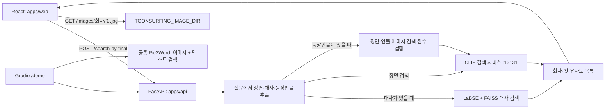
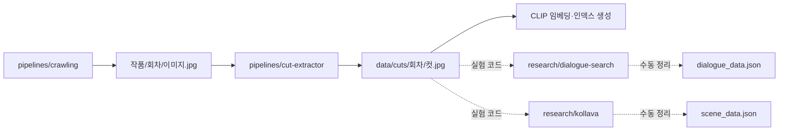

# 구조와 데이터 흐름

## 서비스

`search_by_final`은 OpenAI로 질문을 구조화한 뒤 대사가 있으면 대사 검색을 우선합니다. 대사가 없으면 CLIP으로 장면을 검색하며, 알려진 등장인물이 포함된 경우 장면 검색과 인물 이미지 검색 결과의 교집합에서 점수를 곱해 정렬합니다. Pic2Word는 별도 Gradio 탭과 독립 연구 API에서 사용되며 최종 검색 경로에 자동 연결되어 있지는 않습니다.

FastAPI는 Gradio 서버에 다시 HTTP 요청을 보내던 원본 구조 대신 같은 검색 함수를 직접 호출합니다. LaBSE와 API의 Pic2Word 체크포인트는 실제 사용 시 로드합니다. `/health`는 검색 품질이나 외부 서비스 연결을 검사하는 엔드포인트가 아닙니다.

## 데이터 준비

점선 부분은 원본 연구 코드와 수작업 과정입니다. 수집부터 모든 인덱스를 자동 생성하는 단일 파이프라인은 원본에도 없으며 이번 통합에서 새로 구현하지 않았습니다.

## 공통 코드와 환경

- Pic2Word의 985개 공통 파일은 `research/composed-image-retrieval`에 한 번만 둡니다. `apps/api/func3_pic2word`는 이 디렉터리를 가리키는 상대 심볼릭 링크입니다. API의 고유 체크포인트와 다운로드 스크립트도 공통 경로로 이동했습니다.
- `settings.py`가 API 경로를 저장소 루트 기준으로 계산합니다. 데이터 경로와 CLIP 주소는 환경변수로 설정합니다.
- React 개발 프록시는 `/api` 접두사를 제거해 API로 전달합니다. 프로덕션에서는 `/api/` 역방향 프록시를 구성하거나 빌드 시 `REACT_APP_API_URL`을 설정합니다.
- KoLLaVA는 원본 Docker 환경을 유지합니다. API용 PyTorch 환경과 섞지 않습니다.

## 이력 보존

각 기본 브랜치를 `git subtree add`로 합쳤으며 squash하지 않았습니다. 원본 브랜치와 PR 참조도 이름을 구분하여 가져왔습니다. `.github` 원본의 참조 이름은 Git 참조 규칙 때문에 `upstream/org-profile/...`로 저장됩니다.

인증정보가 발견된 `gradio_demo_api`, `dialogue_search`는 별도 복사본의 전체 이력을 정리한 뒤 가져왔습니다. `docs/sources.json`의 `original_commit`은 원본 기본 브랜치 SHA이고 `imported_commit`은 안전하게 가져온 SHA입니다. 나머지 저장소는 원본 커밋 SHA를 유지합니다. 경로 이동과 공통화 이전의 트리는 `import/2026-10-22` 태그에서 검증할 수 있습니다.
